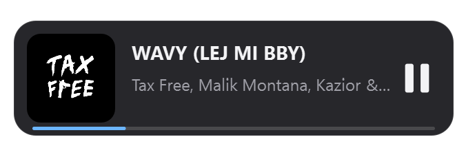
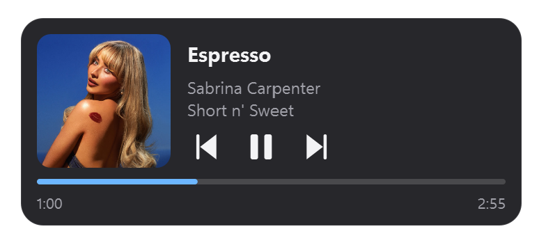
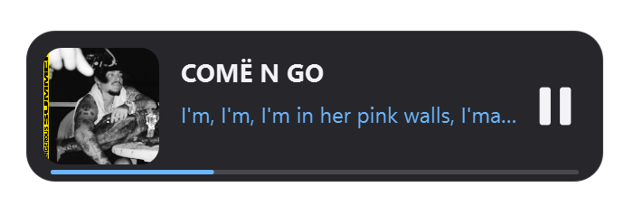
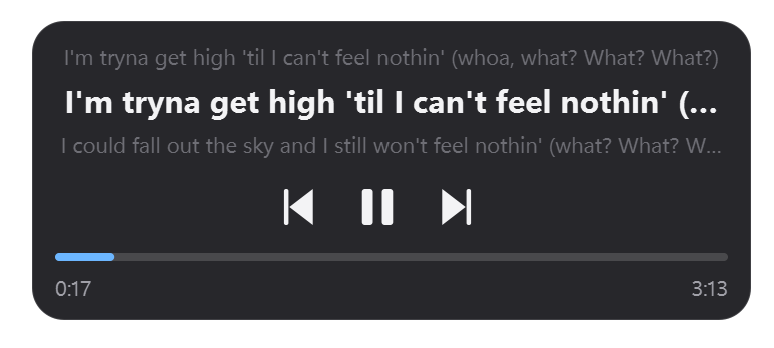
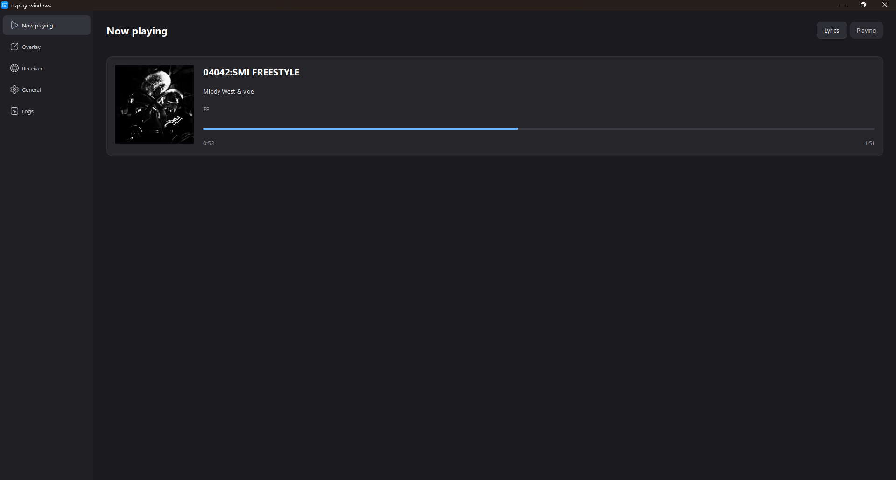
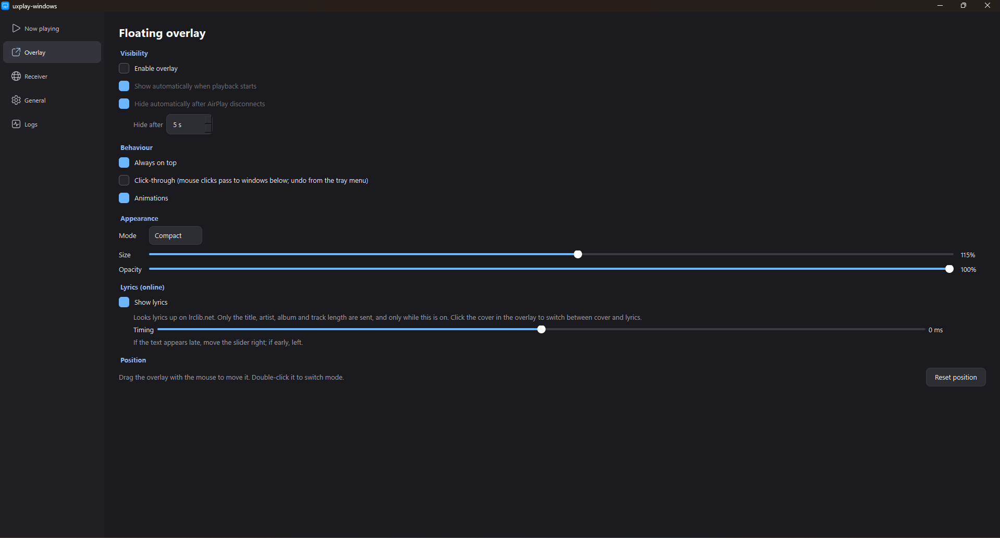
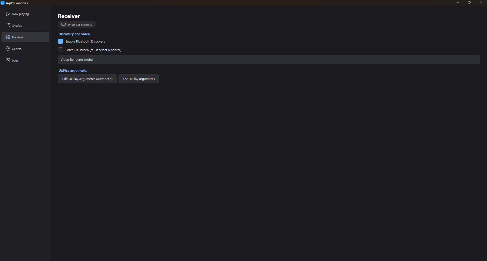

# uxplay-windows: Companion edition

A fork of [leapbtw/uxplay-windows](https://github.com/leapbtw/uxplay-windows) that turns the AirPlay receiver into a small media companion for Windows: a floating now-playing overlay with cover art, remote control of the playing device, and optional time-synced lyrics.

All original features are kept (tray icon, UxPlay engine, autostart, `arguments.txt`, Bluetooth discovery, renderer selection).

> **Status:** works in daily use with an iPhone, but this is a hobby project. Only Windows x64 has been tested.

## Download

1. Open the [latest release](https://github.com/ChestnutBodziu/uxplay-windows/releases/latest) and download `uxplay-windows-x64-portable.zip`.
2. Extract it anywhere and run `uxplay-windows.exe`. Allow it through Windows Firewall when asked.
3. On your iPhone or iPad (same network), choose **uxplay-windows** in AirPlay.

The app is not code-signed, so Windows SmartScreen may warn you (**More info** > **Run anyway**). You can compare the ZIP's SHA-256 with the one in the release notes. Prefer to build it yourself? See [Building](#building).

## Screenshots

**Floating overlay**, compact and expanded:

<p>
  
  
</p>

**Time-synced lyrics** (click the cover to switch between cover and lyrics):

<p>
  
  
</p>

**Main window:**





## What is new

### Floating overlay
- Frameless, always-on-top mini player in the top-right corner (drag it anywhere, the position is remembered).
- Compact mode (cover, title, artist, thin progress line) and expanded mode (album, progress bar with times, transport buttons). Double-click to switch.
- Opacity 20-100%, size 75-150%, optional click-through, fade animations that can be turned off.
- Appears when playback starts, updates on every track change, shows pause, and hides itself some seconds after the device disconnects (all configurable).

### Remote control
Play/pause, next and previous work **from the PC**, over DACP (the protocol the Apple Remote used). The app finds the device's `_dacp._tcp` service via mDNS and sends the commands with the `Active-Remote` header UxPlay already receives. Buttons stay dimmed, with the reason in a tooltip, until the device has actually been found.

### Optional lyrics
Time-synced lyrics from [LRCLIB](https://lrclib.net), shown in the overlay (click the cover to switch between cover and lyrics) and on the Now playing page, with a timing offset to compensate for AirPlay buffering. **Off by default**: when enabled, the title, artist, album and length of the playing track are sent to lrclib.net. Tracks missing from LRCLIB simply show "No lyrics found".

### Redesigned main window
Dark, Windows 11 style window with a sidebar: Now playing, Overlay settings, Receiver, General, Logs.

## What is not possible (and why)

- **Volume and seeking from the PC.** DACP `setproperty` commands are answered with HTTP 400 by iOS unless the remote is paired. Implementing pairing was not worth it, so these are not offered. (The volume slider and seek bar were built, verified against a real iPhone, and removed rather than shipped as fake controls.)
- **Instant pause detection.** iOS sends no "paused" message. A pause is detected when audio packets stop arriving for about 1.5 seconds.
- **Lyrics for every song.** LRCLIB is a community database. New or niche tracks may be missing, and the app does not guess: weak matches are rejected.
- **Name of the source app.** AirPlay does not say which app is playing. When audio arrives without track information (for example from video apps), the overlay shows "Audio from device" instead of guessing.

## How it works

```
iPhone --AirPlay--> UxPlay engine (libuxplay, C/C++)
                        | event callback (connect, metadata, cover, progress, DACP ids, audio activity)
                        v
                  AirPlayEvents  --queued signals-->  MediaState (model)
                                                          |        |
                                      DacpClient <--------+        +--> LyricsState --> LyricsProvider (LRCLIB)
                                      (mDNS + HTTP)                |
                                                          OverlayWindow / Now playing page
```

The engine fork adds one small, additive C API (`uxplay_set_event_callback` in `uxplay_api.h`) and leaves UxPlay's behaviour and command-line options unchanged. The Qt side never touches GStreamer or engine threads: every event is copied and queued to the GUI thread.

Main sources in `src/`: `airplayevents`, `mediastate`, `dacpclient`, `lyrics*`, `overlay*`, `nowplayingpage`, `theme`.

## Building

Requirements (Windows 10/11, x64): [MSYS2](https://www.msys2.org/) in `C:\msys64`, Visual Studio Build Tools with the C++ workload (needed for the Bonjour components), Python 3.14 for Windows, and the .NET SDK for the MSI.

```powershell
git clone --recurse-submodules -b companion https://github.com/ChestnutBodziu/uxplay-windows.git
cd uxplay-windows
.\build.ps1 bootstrap -Architecture x64
.\build.ps1 package -Architecture x64 -SkipInstaller   # portable ZIP, no MSI
```

The result is in `out\x64\artifacts` and, unpacked, in `release\`. See [docs/DEVELOPERS-GUIDE.md](docs/DEVELOPERS-GUIDE.md) for all commands. `scripts/build-bonjour.ps1` picks the newest installed MSVC toolset, so newer Visual Studio versions than 2022 work.

Run the app from `release\uxplay-windows.exe` and allow it through Windows Firewall when asked. The iPhone and the PC must be on the same network.

## Configuration

UxPlay arguments are read from `arguments.txt`, in this order:

1. `%ProgramData%\uxplay-windows\arguments.txt`
2. `%APPDATA%\leapbtw\uxplay-windows\arguments.txt`
3. built-in default: `-n uxplay-windows -nh`

Environment variables are expanded when the app starts, e.g. `-n %COMPUTERNAME% -nh`. Overlay and lyrics settings are stored per user and edited in the app.

The executable is not code-signed, so Windows Defender SmartScreen may ask for confirmation ("More info" > "Run anyway").

## Privacy

The app talks to your device on the local network. The only internet access added by this fork is the optional lyrics lookup on lrclib.net, which is off until you turn it on.

## Credits and license

Built on the work of others:

- [leapbtw/uxplay-windows](https://github.com/leapbtw/uxplay-windows): the Windows app, build system and installer.
- [UxPlay](https://github.com/FDH2/UxPlay): the AirPlay engine (via [leapbtw/libuxplay](https://github.com/leapbtw/libuxplay), forked as [ChestnutBodziu/libuxplay](https://github.com/ChestnutBodziu/libuxplay)).
- [Apple mDNSResponder](https://github.com/apple-oss-distributions/mDNSResponder), Qt and GStreamer.
- [LRCLIB](https://lrclib.net) for lyrics.

This project is licensed under the **GNU General Public License v3.0**, see [LICENSE](LICENSE). Third-party components keep their own licenses (listed in [docs/LICENSE.rtf](docs/LICENSE.rtf)).
